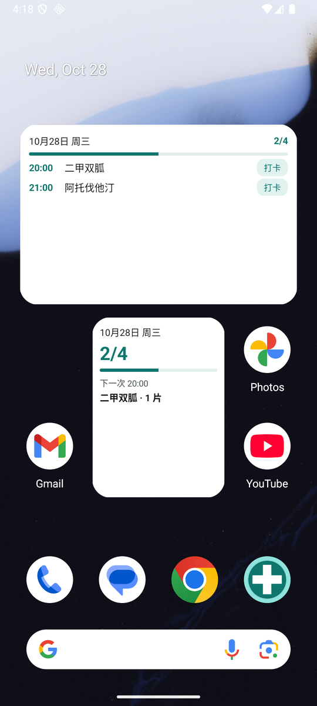
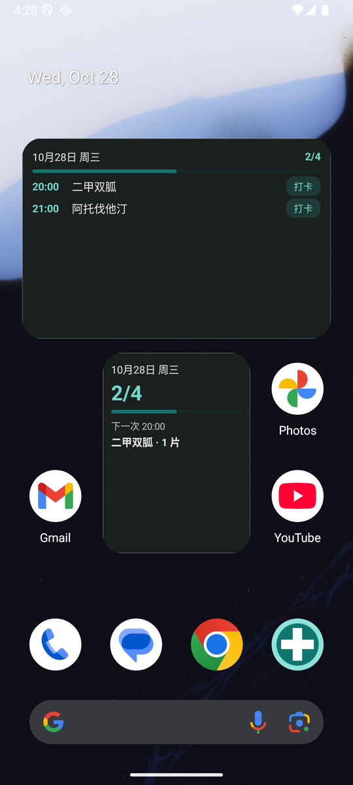
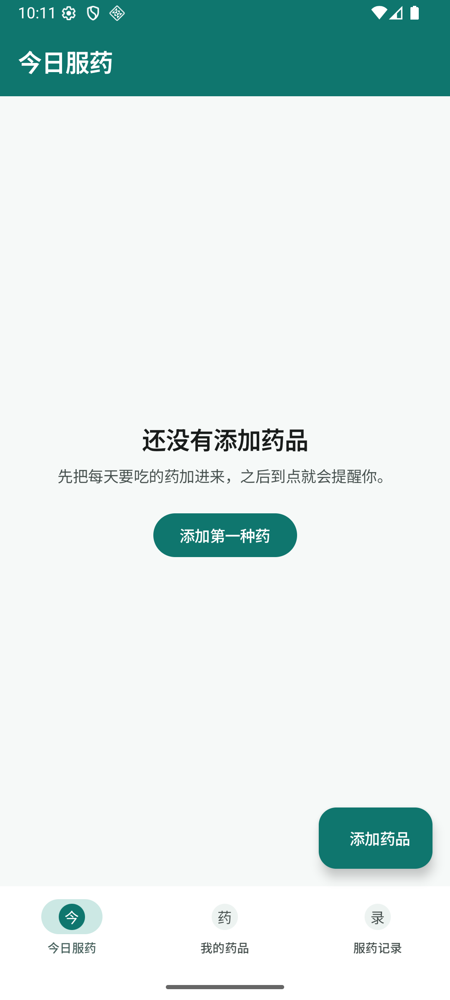
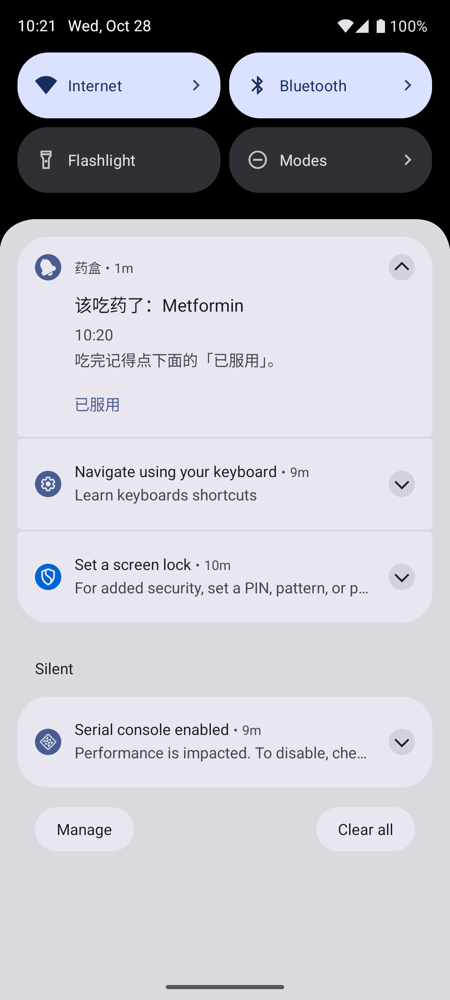

# 药盒 · MedBox

安卓上的极简**吃药记录 + 到点提醒** App，带**桌面小组件**（适配小米 HyperOS / MIUI 与 OPPO ColorOS 桌面）。
纯本地存储，不联网、不上传、无账号，数据只留在你自己手机上。

给自己（或家里老人）用的小工具：把每天要吃的药加进去，到点手机响，吃完了在通知栏或桌面小组件上点一下「打卡」就完成记录。

## 下载安装

到 [**Releases**](https://github.com/ByteJuno/medbox/releases/latest) 下载最新的 `medbox-v*.apk`，传到手机点击安装（需允许「安装未知来源应用」）。

要求：Android 8.0（API 26）及以上。已在 Pixel 8 / Android 16 上跑通全流程（含小组件添加、打卡、深色模式）。

## 截图

| 桌面小组件（浅色） | 桌面小组件（深色） |
|---|---|
|  |  |

| 空状态 | 到点提醒 |
|---|---|
|  |  |

## 功能

**App 内**

- **今日服药** —— 按时间点列出今天要吃的药，一键「已服 / 跳过 / 撤销」，顶部显示 `2 / 4 次已完成` 和进度条
- **我的药品** —— 增删改，一种药可设多个每日时间点（如 08:00 / 13:00 / 20:00）
- **到点提醒** —— AlarmManager 精确闹钟 + 高优先级通知，**通知栏直接点「已服用」就算打卡**
- **开机自恢复** —— 手机重启、应用更新后自动重排闹钟
- **服药记录** —— 近 7 天 / 近 30 天完成率，按天展开看每一条打卡明细

**桌面小组件**

| 小组件 | 尺寸 | 内容 |
|---|---|---|
| **今日服药打卡** | 4×2（可拉伸） | 日期 + 完成进度 + 今天还没吃的药，每行一个「打卡」按钮，**不打开 App 就能记录** |
| **服药进度概要** | 2×2 | 大号 `2/4`、进度条、下一次该吃的时间与药名 |

- 点小组件上的日期/计数 → 打开 App
- 拉高「今日服药打卡」会自动多显示几行（最多 4 行）
- 数据一变（App 内打卡、通知栏打卡、小组件打卡）**立即刷新**
- 跨天自动刷新（内置 0 点闹钟），另有 30 分钟兜底刷新
- 跟随系统深色模式自动切换配色

### 怎么添加小组件

- **小米 HyperOS / MIUI**：长按桌面空白处 → 左下「添加小部件」→ 右上「全部」或搜索「药盒」→ 选择小组件拖到桌面
- **OPPO ColorOS**：长按桌面空白处 → 「小部件」/「卡片」→ 找到「药盒」→ 拖到桌面
- **原生 Android / Pixel**：长按桌面 → Widgets → 药盒

> 小米与 OPPO 桌面都能直接识别标准 AppWidget，不需要装额外适配包。

## 装完必做两件事

否则提醒可能不响（App 内「今日服药」页顶部会显示黄色提示条）：

1. 允许**通知**（Android 13+ 首次启动会弹窗）
2. 系统设置 → 应用 → 药盒 → **闹钟和提醒 → 允许**（Android 12+ 默认可能关闭）

国产 ROM（小米 / 华为 / OPPO / vivo）还需在系统里给本应用开启：**自启动**、**后台运行**、**忽略电池优化**。否则系统会杀掉闹钟——这是所有提醒类 App 的通病，不是本应用特有。

## 自己编译

环境：JDK 17+、Android SDK platform 36、Gradle 8.13（AGP 8.13.0 / Kotlin 2.2.21 / Compose BOM 2025.12.01）。

```bash
# 在项目根目录建 local.properties，写入你的 SDK 路径
# Windows 示例：sdk.dir=D\:\\Android\\Sdk

./gradlew :app:assembleDebug        # Linux / macOS
gradlew.bat :app:assembleDebug      # Windows
```

或直接用 Android Studio 打开本目录。

> 若项目路径含中文，AGP 会拒绝构建，已在 `gradle.properties` 里加 `android.overridePathCheck=true` 绕过。

## 代码结构

```
app/src/main/java/com/medbox/
├── MainActivity.kt          入口：初始化、通知权限申请
├── Store.kt                 数据层：药品 + 记录，JSON 存 filesDir/medbox.json
├── Reminders.kt             闹钟排程、通知构建、ReminderReceiver / BootReceiver
├── Widgets.kt               桌面小组件：RemoteViews 构建、打卡广播、按尺寸排行数
└── ui/
    ├── Theme.kt             Material3 配色（青绿 + 浅灰，支持深色模式）
    ├── App.kt               底部三标签导航、公共组件
    ├── TodayScreen.kt       今日打卡 + 权限提示
    ├── MedsScreen.kt        药品列表、删除确认
    ├── HistoryScreen.kt     完成率统计、按天明细
    └── MedEditorDialog.kt   添加/编辑药品 + 时间选择器

app/src/main/res/
├── layout/widget_today.xml          4×2 小组件布局（固定 4 行，按高度显示）
├── layout/widget_summary.xml        2×2 小组件布局
├── xml/widget_today_info.xml        小组件元数据（尺寸/预览/可缩放）
├── xml/widget_summary_info.xml
└── drawable/widget_*                圆角卡片、按钮底、进度条、预览图
```

技术要点：

- **Kotlin + Jetpack Compose + Material3**，`minSdk 26` / `targetSdk 36`，零第三方依赖（除 AndroidX）
- **数据**用 `org.json` 手写序列化，一个文件搞定，不引入 Room / kotlinx-serialization
- **提醒**用 `AlarmManager.setExactAndAllowWhileIdle`（无精确闹钟权限时降级为 `setAndAllowWhileIdle`），响过后自动排明天；`BOOT_COMPLETED` / `MY_PACKAGE_REPLACED` 后由 `BootReceiver` 补排
- 只申请 4 个权限：`POST_NOTIFICATIONS`、`SCHEDULE_EXACT_ALARM`、`RECEIVE_BOOT_COMPLETED`、`VIBRATE`

### 小组件为什么这么写（国产桌面兼容）

| 坑 | 处理方式 |
|---|---|
| Collection 类小组件（ListView/GridView）在 MIUI、ColorOS 上支持不稳 | 完全不用，改成**布局里写死 4 行**，用 `setViewVisibility` 控制显示 |
| OEM 主题会覆盖 `Button` 的默认样式 | 不用 `Button`，用 `TextView` + 自绘圆角背景当按钮 |
| 部分桌面不认 `previewLayout`（Android 12+ 才有） | 同时提供 `previewImage` 矢量预览图兜底旧系统 |
| 各桌面格子尺寸换算不一致 | 按「每格 70dp − 30dp」给 `minWidth/minHeight`，并用 `targetCellWidth/Height` 声明 4×2 / 2×2 |
| 用户拉伸后内容挤在一起 | 读 `OPTION_APPWIDGET_MIN_HEIGHT` 动态决定显示 1~4 行 |
| 父容器点击会抢掉按钮点击 | 只让顶部日期/计数负责"打开 App"，打卡按钮独立，两块热区不重叠 |
| 跨天后小组件还停在昨天 | 内置 0 点闹钟定时刷新 + `updatePeriodMillis` 30 分钟兜底 |

## 已知限制（v0.2）

- 单机数据，换手机需手动迁移（`/data/data/com.medbox/files/medbox.json`，暂无可视化导出）
- 「应服次数」按药品加入日期推算，改服药时间不会回溯修正历史统计
- 小组件里只能「标记已服」，不能「跳过」或撤销（要撤销请点开 App）
- 没有库存管理、没有家人共享、没有 CSV 导出

## Roadmap

- [x] 桌面小组件（4×2 打卡 + 2×2 概要，适配小米/OPPO 桌面）
- [ ] 库存与补药提醒
- [ ] 导出 CSV（复诊给医生看）
- [ ] JSON 备份 / 恢复
- [ ] 多设备同步

## 版本历史

- **v0.2.0** —— 新增两个桌面小组件；支持深色模式配色；小组件内直接打卡；跨天自动刷新
- **v0.1.0** —— 首个可用版本：今日打卡、药品管理、精确闹钟提醒、服药记录统计

## License

[MIT](LICENSE)。仅用于记录与提醒，不提供任何医疗建议；用药请遵医嘱。
